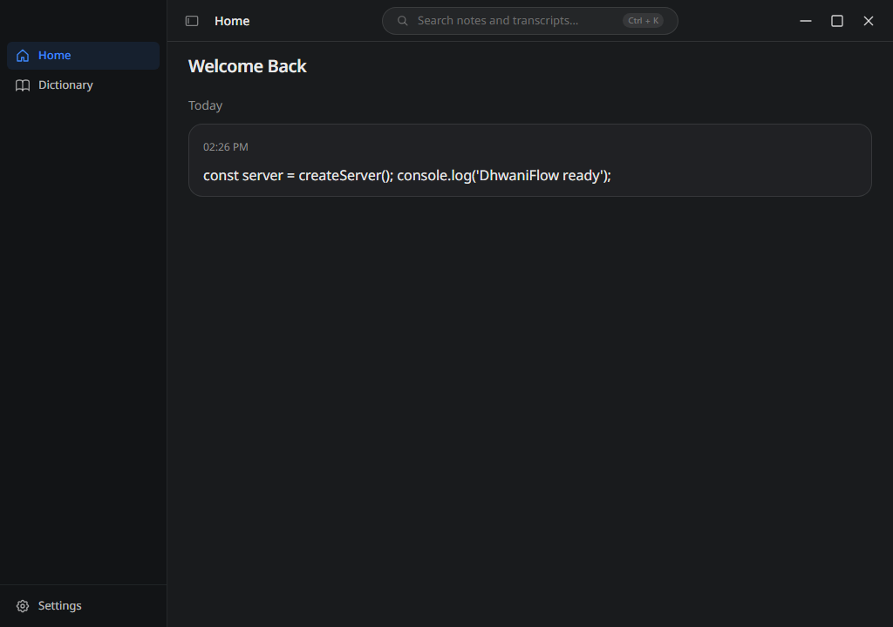
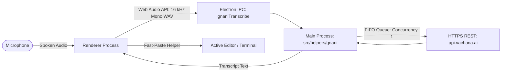

# DhwaniFlow

DhwaniFlow is an open-source Hinglish voice dictation desktop app for developers, powered by the Gnani speech API. It captures technical speech, code syntax, and mixed Hindi-English instructions, transcribes them using Gnani's Indic foundation models, and pastes the result directly at your active cursor.

---

## Demo


*(DhwaniFlow desktop interface with real-time dictation, vocabulary management, and quick settings)*

---

## Quick Start

Windows 10/11 (64-bit) is the primary tested and supported platform.

### 1. Download & Install

- Download the latest installer (`DhwaniFlow-Setup-1.11.0.exe`) from [Releases](https://github.com/abhinavtiwary15/DhwaniFlow/releases), or build locally from source (`npm run build:win`).
- Run the installer to set up DhwaniFlow on your Windows desktop.

### 2. Configure Your Gnani API Key

1. Launch DhwaniFlow. On first launch, the Onboarding flow guides you through microphone permissions and Gnani setup.
2. Alternatively, open **Settings** (`Ctrl+,`) and navigate to **Speech-to-Text**.
3. Paste your Gnani Vachana API key and click **Save Key**. The key is encrypted locally using the operating system credential vault (`safeStorage` via Windows DPAPI).
4. Choose your preferred dictation language (default: `Hindi (hi-IN)`).

### 3. Native Fast-Paste Helper

DhwaniFlow uses a compiled Windows fast-paste helper (`resources/bin/windows-fast-paste.exe`) for instantaneous cursor insertion. If compiling from source without a C compiler (`gcc` or MSVC `cl.exe`), DhwaniFlow transparently falls back to `nircmd.exe` or PowerShell clipboard pasting.

### 4. Dictate Anywhere

1. Focus any code editor (VS Code, Cursor), terminal, or browser.
2. Press the global dictation hotkey (default: `Ctrl+Shift+K`) to start recording.
3. Speak in Hinglish (e.g., *"bhai useState hook banao with count and setCount"*).
4. Press `Ctrl+Shift+K` again (or release in push-to-talk mode) to transcribe and paste directly into your active window.

---

## How It Works

DhwaniFlow operates on a streamlined, two-tier architecture within Electron, with zero local server daemons and no external FFmpeg binary:



1. **In-Browser Audio Encoding**: The renderer captures microphone input via the Web Audio API and encodes it directly into a standard 16 kHz 16-bit mono PCM WAV buffer (`src/audio/wav-encoder.js`). No external FFmpeg binary or local transcoding daemon is needed.
2. **Typed Electron IPC**: Audio buffers and configuration are passed to Electron's main process via typed IPC (`gnani:transcribe`).
3. **In-Process Gnani Module**: The main process (`src/helpers/gnani/`) handles request serialization (strict concurrency 1 via `FifoQueue`), automatic HTTP 429 exponential backoff, custom vocabulary biasing, and RMS energy-based silence chunking for audio exceeding 30 seconds.
4. **Direct HTTPS Transmission**: Audio buffers are delivered securely over HTTPS to Gnani's Vachana STT endpoint (`https://api.vachana.ai/stt/v3`).
5. **Cursor Insertion**: The received transcript is typed or pasted at the active cursor using the native fast-paste helper, after which temporary audio buffers are immediately revoked.

---

## Features

- **Hinglish-First Dictation**: Optimized for code-mixed Hindi-English technical speech and developer workflows.
- **Zero-Daemon Architecture**: Fully in-process speech pipeline—no background local servers, Python daemons, or FFmpeg runtime requirements.
- **Global Hotkey & Fast-Paste**: Global shortcuts (`Ctrl+Shift+K`) with instant focus restoration and native keyboard paste automation.
- **Indic Foundation Models**: Powered by Gnani Prisma v3.0 Speech-to-Text supporting Hindi and 11+ Indic languages.
- **Custom Dictionary & Vocabulary Biasing**: Injects developer terms, function names, and custom identifiers into STT keyterms.
- **Local-First Security**: API keys are encrypted with Windows DPAPI via Electron's `safeStorage`; no telemetry or account tracking.
- **Audio Silence Segmentation**: Non-destructive RMS energy silence splitting with boundary deduplication for long dictations.

---

## Project Vocabulary Biasing

To accurately recognize technical jargon, library names, and camelCase identifiers in Hinglish speech, DhwaniFlow primes Gnani's foundation model with contextual vocabulary:
- **Custom Dictionary**: User-defined words and domain terms from the Dictionary view are prioritized.
- **Developer Vocabulary**: Standard programming keywords and common developer terms (`src/helpers/gnani/data/dev-terms.json`) complement user entries.
- **Payload Budgeting**: Terms are sanitized, deduplicated case-insensitively, and budgeted to Gnani's maximum payload limit of 200 terms and 2,000 characters.
- *(Note: Full automated workspace AST scanning is documented in [docs/known-gaps.md](docs/known-gaps.md) as an unfinished internal helper; user-configured dictionary terms are actively delivered to Gnani on every dictation).*

---

## Benchmark Summary

Hinglish speech recognition performance evaluated across 30 developer sentences and 3 acoustic conditions (Gnani Prisma v3.0 vs OpenAI Whisper):

<!-- BENCHMARK_TABLE_START -->

| Audio Condition | Gnani (All / Held-out) | Whisper large-v3 (Prompted - All / Held-out) | Delta Overall | Delta Held-Out | 95% Bootstrap CI (Overall) | 95% Bootstrap CI (Held-out) |
|:---|:---:|:---:|:---:|:---:|:---:|:---:|
| **`clean`** | 85.3% / 88.3% | 80.2% / 79.0% | **+5.2%** | **+9.3%** | [-6.9%, +17.2%] | [-5.6%, +24.1%] |
| **`phone8k`** | 86.2% / 88.3% | 81.0% / 84.6% | **+5.2%** | **+3.7%** | [-6.0%, +16.4%] | [-7.4%, +14.8%] |
| **`phone8k_noise`** | 85.3% / 86.4% | 73.8% / 75.3% | **+11.5%** | **+11.1%** | [+2.6%, +23.6%] | [+0.0%, +25.9%] |

<!-- BENCHMARK_TABLE_END -->

See [docs/benchmark-methodology.md](docs/benchmark-methodology.md) for benchmark setup, dataset details, and evaluation protocols.

---

## Limitations

- **Single Speaker**: Benchmark audio recordings were gathered from a single male native Hindi speaker. Regional accent diversity testing is planned.
- **Dataset Size**: The core evaluation dataset comprises 30 developer sentences, resulting in wide bootstrap confidence intervals.
- **Derived Conditions**: Clean, telephony (8 kHz bandpass), and noise conditions were derived synthetically from identical source recordings and are not statistically independent.
- **Synthetic Noise and Telephony**: Phone degradation was synthesized with G.711 $\mu$-law filtering, and noise was digitally added from synthetic babble/traffic audio.
- **Whisper Reference**: Whisper `large-v3` was evaluated locally on CPU with int8 quantization (`whisper.cpp`).
- **Single Request Concurrency**: Gnani API keys enforce a limit of 1 active in-flight request at a time; consecutive requests are serialized in a FIFO queue.
- **Cloud Latency**: Speech recognition requires an external HTTPS round-trip to `api.vachana.ai` (typically 2 to 5 seconds depending on audio duration and network latency).
- **Project Identifier Biasing**: When project identifiers were given to both engines as hints, Whisper `large-v3` performed better than Prisma on exact token matches (72.7% for Whisper vs 22.7% for Prisma, $n = 22$ identifiers).

---

## Project Layout

```text
DhwaniFlow/
├── benchmark/            # Benchmark datasets, evaluation runners, and results
├── docs/                 # Architecture, known gaps, methodology, and assets
│   └── assets/           # Screenshots and interface diagrams
├── resources/            # Icons, Windows installer scripts (NSIS), native paste C source
├── scripts/              # CI test runner, release packaging, hygiene validation
├── src/                  # Main and renderer application source code
│   ├── audio/            # Web Audio 16 kHz PCM WAV encoder
│   ├── components/       # React UI (Control Panel, Onboarding, Settings)
│   ├── config/           # Application constants and configuration
│   ├── helpers/
│   │   └── gnani/        # In-process Gnani STT client, queue, keyterms, silence chunker
│   ├── locales/          # UI localization files (English and community locales)
│   ├── stores/           # Zustand state management stores
│   └── types/            # TypeScript type definitions and IPC interfaces
└── test/                 # Retained unit and integration test suites
```

---

## Credits

DhwaniFlow is built on OpenWhispr (MIT) by its contributors. See LICENSE.
