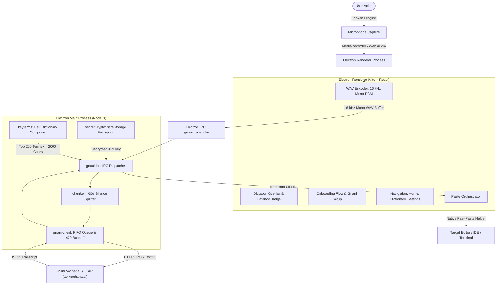

# DhwaniFlow Architecture

DhwaniFlow is an open-source desktop voice dictation application built for software engineers who think and communicate in Hinglish (code-mixed Hindi and English). It is built upon the desktop foundation of OpenWhispr (Electron + Vite + React) and powered by Gnani's **Prisma v3.0** Speech-to-Text foundation model.

---

## 1. High-Level System Architecture

DhwaniFlow operates across two process tiers within Electron, with zero local server daemons and no external FFmpeg binary:

1. **Electron Renderer (Vite/React)**:
   - Voice dictation pill overlay, recording states, and real-time latency badge tracking.
   - In-browser audio normalization and encoding into 16 kHz mono WAV via the Web Audio API.
   - Onboarding flow with dedicated Gnani setup step (API key validation, save, language selector).
   - Clean, consolidated navigation: Home, Dictionary, Settings (General, Hotkeys, Speech, Privacy, System, About).
   - Target window refocus and clipboard paste execution.
2. **Electron Main Process**:
   - Window lifecycle, global OS hotkeys (`Ctrl+Shift+K`), and power save management.
   - OS-level credential protection via Electron `safeStorage` (Windows DPAPI, macOS Keychain).
   - In-process Gnani orchestration (`src/helpers/gnani/`): request queuing, vocabulary biasing, silence splitting, and direct HTTPS calls.

---

## 2. Audio Processing Pipeline

1. **In-Browser Audio Encoding (`src/audio/wav-encoder.js`)**:
   - The user triggers recording via the global dictation hotkey (default `Ctrl+Shift+K`).
   - Audio is captured through the browser `MediaRecorder` API.
   - When recording stops, `wavFromBlob()` decodes the recorded audio using an `OfflineAudioContext` (resampling to 16,000 Hz and downmixing to mono if necessary) and packs it into a compliant 16-bit PCM WAV format.
   - If audio is already a compliant 16 kHz mono WAV buffer, `is16kMonoWavBuffer()` performs zero-copy passthrough.
   - This eliminates any runtime dependency on FFmpeg or local transcoding daemons.
2. **Silence Segmentation for Long Recordings (`src/helpers/gnani/chunker.js`)**:
   - Gnani's Vachana API enforces a 30-second duration limit per HTTP request.
   - For audio clips exceeding 30 seconds, `chunkWavBuffer()` detects root-mean-square (RMS) energy dips to split audio non-destructively at natural silence intervals (between 20s and 28s), falling back to hard cuts with 300ms boundary overlap if no silence is detected.
3. **Boundary Word Deduplication**:
   - Split chunks are transcribed sequentially through the queue.
   - `dedupeBoundaryWords()` inspects trailing tokens of chunk $N$ and leading tokens of chunk $N+1$ (ignoring punctuation and casing) to eliminate stutter caused by boundary overlap.
4. **Immediate Storage Cleanup**:
   - Temporary recording blobs and object URLs are immediately revoked and deleted upon transcription completion, preserving privacy and freeing memory.

---

## 3. Keyterm Biasing & Vocabulary Composition

Accurately recognizing code identifiers and technical terms in Hinglish requires domain-specific vocabulary priming:

1. **Composition Pipeline (`src/helpers/gnani/keyterms.js`)**:
   - Custom user dictionary entries (`dictionaryStore`) are prioritized first.
   - Standard development keywords from `src/helpers/gnani/data/dev-terms.json` are appended.
   - Identifiers are deduplicated case-insensitively and sanitized.
   - The final term list is capped at 200 terms and 2,000 total characters to strictly adhere to Gnani API payload budgets.
2. **Payload Delivery**:
   - Composed keyterms are sent in the `keyterms` payload field of the multipart HTTPS request to `https://api.vachana.ai/stt/v3`.

---

## 4. Request Queuing, Concurrency, and Error Handling

1. **Serialized Execution (`src/helpers/gnani/gnani-client.js`)**:
   - Gnani API accounts permit 1 concurrent in-flight transcription.
   - `FifoQueue` serializes all outgoing requests so that consecutive hotkey presses or split audio chunks execute sequentially without overlapping.
2. **HTTP 429 Rate Limit Backoff**:
   - In the event of an upstream HTTP 429 response, the client automatically backs off with jitter and retries before surfacing an error.
3. **Structured Error Handling**:
   - Errors are categorized into typed codes (`NO_KEY`, `BAD_KEY`, `RATE_LIMITED`, `OFFLINE`, `TOO_LONG`).
   - The UI displays user-friendly overlay messages with clear action prompts (e.g. directing the user to Speech Settings if the key is missing or invalid).

---

## 5. Native Fast-Paste Cursor Insertion

1. **Native Helper Execution**:
   - On Windows, DhwaniFlow invokes `resources/bin/windows-fast-paste.exe` (compiled from `resources/windows-fast-paste.c`).
   - If a C compiler was unavailable during installation, it automatically falls back to `resources/bin/nircmd.exe` or PowerShell clipboard injection.
2. **Focus Restoration**:
   - DhwaniFlow restores OS window focus to the active IDE, code editor, or terminal before injecting the paste keystroke (`Ctrl+V` or `Cmd+V`).

---

## 6. Security, Privacy, and Sandboxing

1. **Sandboxed Window Architecture**:
   - All browser windows (including the main window and control panel) enforce `sandbox: true`, `webSecurity: true`, and `nodeIntegration: false`.
   - Communication between the renderer and main process is strictly mediated through explicit, typed preload bridges (`preload.js`).
2. **Hardened Content Security Policy (CSP)**:
   - External network connections are restricted strictly to authorized endpoints:
     - `default-src 'self'`
     - `connect-src 'self' https://api.vachana.ai https://api.openai.com`
     - `img-src 'self' data: blob:` (remote avatar and CDN hosts completely removed)
3. **Encrypted Local Storage**:
   - Gnani API keys are stored encrypted using Electron's `safeStorage` API, which leverages Windows DPAPI on Windows and Apple Keychain on macOS.
   - Raw keys are never written to disk in plain text or emitted to logs.
